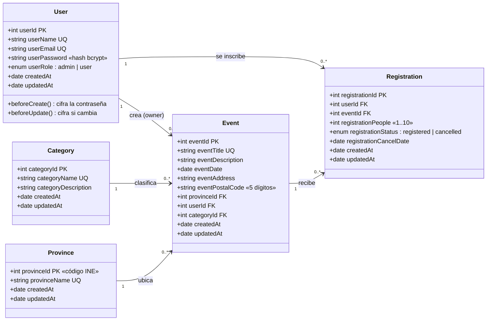

# JoinUp — Gestor de eventos y planes

JoinUp es una aplicación web para apuntarse a eventos. Cada usuario se registra, ve los eventos que hay, y se inscribe diciendo cuántas personas van. Además hay un usuario administrador que gestiona categorías, usuarios y eventos.

La aplicación tiene una **web** con vistas EJS, para usarla desde el navegador.

**Equipo:** Adrián, Carmen, Eder y Pipe.

## Índice

1. [Funcionalidades](#funcionalidades)
2. [Tecnologías y APIs utilizadas](#tecnologías-y-apis-utilizadas)
3. [Instalación y despliegue local](#instalación-y-despliegue-local)
4. [Guía rápida de uso](#guía-rápida-de-uso)
5. [Base de datos](#base-de-datos)
6. [Estructura del proyecto](#estructura-del-proyecto)
7. [Próximas mejoras](#próximas-mejoras)

---

## Funcionalidades

- **Registro e inicio de sesión.** Se comprueba que el correo y el nombre de usuario no existan ya. La contraseña se cifra con bcrypt (10 rondas de sal) y el usuario se guarda con rol `user`. Al iniciar sesión se compara la contraseña con el hash usando `bcrypt.compare`.
- **Eventos.** Se pueden ver, editar y borrar. El listado trae cada evento con su provincia y su categoría en una sola consulta (`include` de Sequelize).
- **Inscripciones.** Un usuario se apunta a un evento indicando cuántas personas van (de 1 a 10) y ve sus inscripciones junto con el título y la descripción del evento.
- **Categorías.** Se pueden listar y consultar. Solo el administrador puede editarlas y borrarlas.
- **Gestión de usuarios.** El administrador ve la lista de usuarios y puede eliminar los que no tengan eventos creados.
- **Roles.** Hay dos: `user` y `admin`.

---

## Tecnologías

| Tecnología | Para qué la usamos |
| --- | --- |
| Node.js 20 | Ejecutar el servidor, con módulos ES (`import` / `export`) |
| Express 5 | Rutas y peticiones |
| EJS | Plantillas HTML para las vistas, con partes reutilizables |
| Sequelize | ORM para hablar con la base de datos |
| PostgreSQL 18 | Base de datos relacional |
| bcrypt | Cifrar las contraseñas |
| express-session | Guardar quién ha iniciado sesión |
| cors | Permitir peticiones a la API desde otros orígenes |
| dotenv | Variables de entorno (`.env`) |
| nodemon | Reiniciar el servidor al guardar un archivo |
| Docker y Docker Compose | Ejecutar la app, la base de datos y pgAdmin en contenedores |
| pgAdmin 4 | Consultar y administrar la base de datos desde el navegador |
| JSDoc | Generar la documentación del código |
| Git y GitHub | Trabajar en equipo y repartir el código |

---

## Instalación y despliegue local

### Requisitos

- [Docker Desktop](https://www.docker.com/products/docker-desktop/) (o Docker Engine con el plugin Compose)
- Git

No hace falta instalar Node.js ni PostgreSQL en local: todo corre dentro de Docker.

### 1. Clonar el repositorio

```bash
git clone https://github.com/carmen-2026-design/project_backend_group.git
cd project_backend_group
```

### 2. Crear el `.env`

Crea un archivo `.env` en la raíz con estas variables (los valores son de ejemplo):

```env
# Aplicación
APP_HOST=
APP_PORT=
SESSION_SECRET=

# PostgreSQL
POSTGRES_HOST=
POSTGRES_PORT=
POSTGRES_USER=
POSTGRES_PASSWORD=
POSTGRES_DB=

# pgAdmin
PGADMIN_HOST=
PGADMIN_EMAIL=
PGADMIN_PASSWORD=
PGADMIN_PORT=
```

> El `.env` no se sube a Git.
>
> Dentro de Docker, la app se conecta a la base de datos usando `POSTGRES_HOST`, que es el nombre del contenedor de PostgreSQL, no `localhost`.

### 3. Levantar los contenedores

```bash
docker compose up --build
```

Al arrancar pasa lo siguiente:

1. nodemon lanza `node src/index.js`.
2. Se cargan las variables del `.env`.
3. La app comprueba la conexión con PostgreSQL. Si falla, lo reintenta hasta 5 veces, cada 5 segundos.
4. Si todo va bien, en los logs aparecen los mensajes "Conexión establecida con la base de datos" y "Aplicación en marcha".

La primera vez, PostgreSQL ejecuta los scripts de la carpeta `sql/` por orden alfabético:

1. `01_schema.sql` crea las tablas.
2. `02_seed.sql` carga los datos de prueba.

### 4. Abrir la aplicación

| Servicio | Qué es | URL |
| --- | --- | --- |
| `app` | Node + Express con nodemon | <http://localhost:3000> (o el `APP_PORT` que pongas) |
| `postgres` | PostgreSQL 18 | Solo accesible dentro de Docker |
| `pgadmin` | Cliente web de la base de datos | <http://localhost:8080> (o el `PGADMIN_PORT` que pongas) |

Para conectarte desde pgAdmin, registra un servidor con:

- **Host:** el valor de `POSTGRES_HOST`
- **Puerto:** `5432`
- **Usuario y contraseña:** los del `.env`

### Comandos habituales

| Comando | Para qué |
| --- | --- |
| `docker compose up --build` | Arrancar y reconstruir si cambió `package.json` |
| `docker compose up -d` | Arrancar en segundo plano |
| `docker compose logs -f app` | Ver los logs de la app |
| `docker compose down` | Parar los contenedores. **Los datos se conservan** |
| `docker compose down -v` | Parar y **borrar la base de datos**. Al volver a arrancar se recarga desde `sql/` |
| `docker compose exec app npm install <paquete>` | Instalar un paquete dentro del contenedor |
| `npm run docs` | Generar la documentación con JSDoc |

> ⚠️ Los scripts de `sql/` **solo se ejecutan si el volumen de datos está vacío**. Si cambias el esquema o los datos de prueba, ejecuta `docker compose down -v` antes de volver a arrancar.

---

## Guía rápida de uso

### Usuarios de prueba

| Nombre | Email | Contraseña | Rol |
| --- | --- | --- | --- |
| Admin JoinUp | admin@joinup.com | `admin` | admin |
| Laura Martínez | laura.martinez@example.com | `user` | user |
| Carlos Gómez | carlos.gomez@example.com | `user` | user |
| Lucía Fernández | lucia.fernandez@example.com | `user` | user |

Los datos de prueba incluyen:

- 8 usuarios
- las 52 provincias
- 5 categorías: Deportes, Música, Tecnología, Cultura y Gastronomía
- 10 eventos, dos de ellos ya pasados
- 18 inscripciones, tres de ellas canceladas

### Como usuario

1. **Crea una cuenta** en `/auth/register` o entra con un usuario de prueba en `/auth/login`.
2. **Explora los eventos** en `/event`. Cada evento muestra su fecha, dirección, provincia y categoría.
3. **Apúntate a un evento** desde `/registration/new`. Indica cuántas personas vais, entre 1 y 10.
4. **Revisa tus inscripciones** en `/registration`. Desde ahí puedes editarlas o cancelarlas.
5. **Edita tu plan** en `/event/edit`. Tendrás que indicar título, fecha, dirección, código postal de 5 dígitos, provincia y categoría.
6. **Cierra sesión** en `/auth/logout`.

### Como administrador

Entra con `admin@joinup.com` / `admin`. Además de todo lo anterior, puedes:

1. **Gestionar categorías** en `/category`: editarlas y borrarlas. Una categoría con eventos no se puede borrar.
2. **Gestionar usuarios** en `/user`: verlos y eliminar los que no tengan eventos creados.
3. **Gestionar cualquier evento** en `/event`: editarlo o borrarlo.

### Rutas web

| Ruta | Qué hace |
| --- | --- |
| `/auth/register` · `/auth/login` · `/auth/logout` | Registro, inicio y cierre de sesión |
| `/event` | Listado, detalle (`/:id`), editar (`/:id/edit`) y borrar (`/:id/delete`) eventos |
| `/registration` | Listado, detalle, editar y borrar inscripciones |
| `/category` | Listado y detalle. Editar y borrar: solo admin |
| `/user` | Listado, detalle, crear, editar y borrar usuarios |

Los formularios HTML solo envían GET y POST, así que editar y borrar se hacen con rutas POST (`/:id/edit`, `/:id/delete`).

---

## Base de datos



| Tabla | Campos principales | Relaciones |
| --- | --- | --- |
| `users` | `user_id`, `user_name`, `user_email` (único), `user_password` (hash bcrypt), `user_role` (`admin` \| `user`) | Un usuario crea muchos eventos y tiene muchas inscripciones |
| `categories` | `category_id`, `category_name` (único), `category_description` | Una categoría tiene muchos eventos |
| `provinces` | `province_id` (código INE), `province_name` | Una provincia tiene muchos eventos |
| `events` | `event_id`, `event_title` (único), `event_description`, `event_date`, `event_address`, `event_postal_code`, `province_id`, `user_id`, `category_id` | Pertenece a una provincia, una categoría y un usuario creador |
| `registrations` | `registration_id`, `user_id`, `event_id`, `registration_people` (1–10), `registration_status` (`registered` \| `cancelled`), `registration_cancel_date` | Une usuarios y eventos (muchos a muchos) |

Todas las tablas tienen `created_at` y `updated_at`.

La propia base de datos aplica estas reglas:

- **Código postal.** Tiene que tener 5 dígitos y se guarda como texto para conservar el cero inicial (por ejemplo, `08001`).
- **Inscripciones.** Un usuario no puede inscribirse dos veces al mismo evento (`UNIQUE (user_id, event_id)`).
- **Borrado de eventos.** Las claves foráneas de `events` usan `ON DELETE RESTRICT`: PostgreSQL no deja borrar una categoría, una provincia o un usuario que todavía tenga eventos.
- **Borrado de inscripciones.** Al borrar un evento o un usuario se borran también sus inscripciones (`ON DELETE CASCADE`).

En PostgreSQL las columnas están en `snake_case` (`event_title`) y Sequelize las convierte a `camelCase` (`eventTitle`) en el código.

---

## Estructura del proyecto

```
project_backend_group/
├── sql/
│   ├── 01_schema.sql          # crea las tablas
│   └── 02_seed.sql            # datos de prueba
├── public/
│   └── css/style.css
├── docs/                      # memoria técnica
├── src/
│   ├── index.js               # arranca el servidor y comprueba la conexión
│   ├── config/db.js           # instancia de Sequelize
│   ├── models/                # User, Event, Category, Registration, Province
│   ├── repositories/          # consultas a la base de datos con Sequelize
│   ├── controllers/           # auth, user, category, event, registration
│   │                          #   *.view.controller.js → res.render()
│   │                          #   *.api.controller.js  → res.json()
│   ├── routes/
│   │   ├── router.js
│   │   └── view/              # rutas web (EJS)
│   │   
│   ├── middlewares/
│   │   └── auth.middleware.js # isAuthenticated, isAdmin
│   ├── utils/errors.js        # traduce errores de Sequelize a mensaje + código HTTP
│   └── views/                 # plantillas EJS por carpetas
├── Dockerfile
├── docker-compose.yml
├── jsdoc.json
└── package.json
```

Cada petición sigue este recorrido:

1. El navegador hace la petición.
2. La ruta la envía a su controlador.
3. El controlador pide los datos al repositorio.
4. El repositorio consulta la base de datos.
5. Los datos vuelven al controlador, que renderiza la vista EJS.

---

## Próximas mejoras

- Quitar los `console.log` de depuración, sobre todo los que imprimen la contraseña y el usuario al hacer login.
- Mostrar un mensaje claro (por ejemplo, "No se puede borrar una categoría que tiene eventos") en lugar de un error 500.
- Pedir la lista de categorías una sola vez por petición.
- Posibilidad de añadir eventos y categorías.
- Añadir información adicional en la visualización de eventos y categorías.
- Añadir paginación al listado de eventos.
- Añadir la gestión de usuarios admin.
- Añadir pruebas automáticas.
- Trabajar con una rama de Git por funcionalidad.
