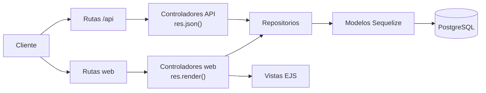
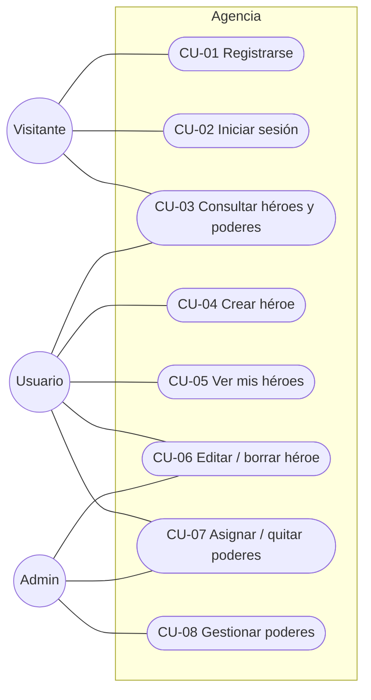
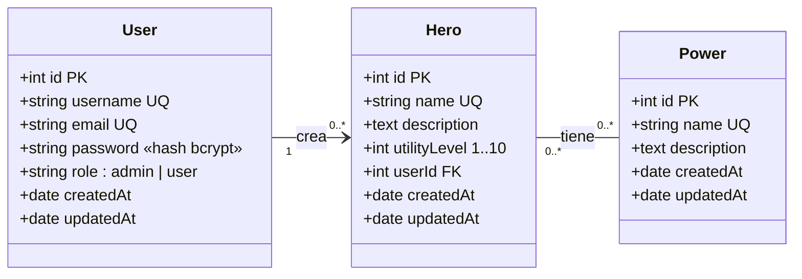
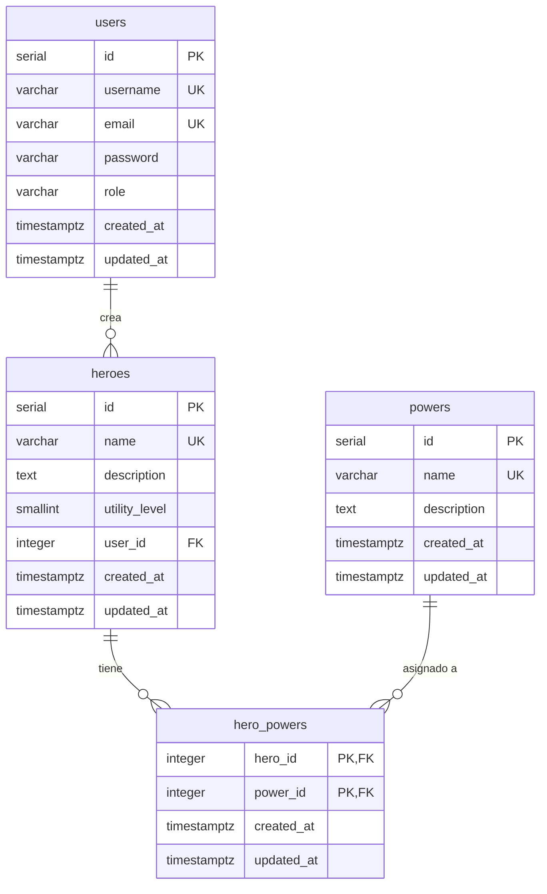
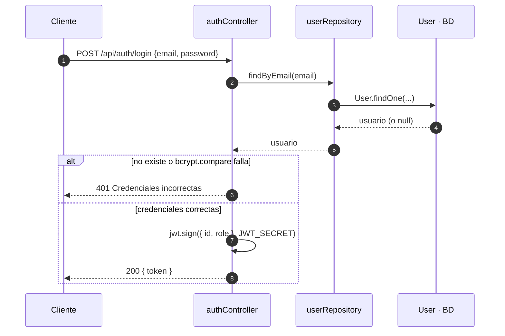
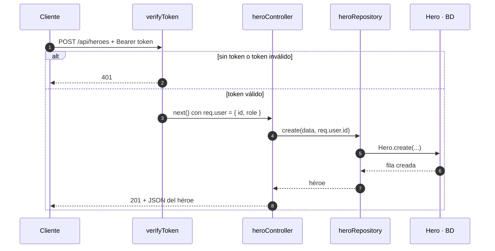

# Agencia de Superhéroes de Segunda — Memoria técnica

## Índice

1. [Contexto y objetivos](#1-contexto-y-objetivos)
2. [Tecnologías y arquitectura](#2-tecnologías-y-arquitectura)
3. [Análisis de requisitos](#3-análisis-de-requisitos)
4. [Casos de uso y permisos](#4-casos-de-uso-y-permisos)
5. [Diagrama de clases y modelo de datos](#5-diagrama-de-clases-y-modelo-de-datos)
6. [Diseño de la API REST y rutas web](#6-diseño-de-la-api-rest-y-rutas-web)
7. [Flujos principales](#7-flujos-principales)
8. [Plan de desarrollo](#8-plan-de-desarrollo)

---

## 1. Contexto y objetivos

La Agencia de Superhéroes de Segunda es una aplicación web para registrar héroes con poderes poco espectaculares pero muy útiles en el día a día: Capitán Wifi, Doctor Cargador o Señora Táper. Cualquier persona puede consultar el catálogo; los usuarios registrados crean sus propios héroes y les asignan poderes; el administrador mantiene el catálogo de poderes.

La gracia del dominio es que una misma persona puede tener varias identidades secretas: un usuario puede ser a la vez Capitán Wifi entre semana y El Fantasma del Trastero los sábados.

### Objetivos didácticos

El proyecto es pequeño a propósito (3 entidades) pero cubre los conceptos principales del backend:

- **Arquitectura MVC + repositorios**: rutas → controladores → repositorios → modelos, con vistas EJS y API REST compartiendo los mismos repositorios.
- **Relación 1:N**: un usuario crea muchos héroes.
- **Relación N:M**: un héroe tiene muchos poderes y un poder lo tienen muchos héroes.
- **Autenticación**: registro y login con contraseñas cifradas (bcrypt) y JWT.
- **Autorización**: por rol (solo el admin gestiona poderes) y por propiedad (solo el creador o el admin modifica un héroe).

### Alcance

Dentro: gestión de usuarios, héroes y poderes; asignación de poderes a héroes; vistas web sencillas y API REST JSON.

Fuera (posibles ampliaciones): incidentes y misiones, subida de imágenes, paginación avanzada, tests y despliegue.

---

## 2. Tecnologías y arquitectura

La aplicación es un único servidor Express que sirve dos interfaces (web con EJS y API REST en `/api`) sobre la misma lógica de acceso a datos. Todo el entorno (aplicación y base de datos) se levanta con Docker Compose.

| Pieza | Tecnología |
| --- | --- |
| Entorno | Node.js 20 (módulos ES) |
| Servidor | Express |
| Base de datos | PostgreSQL 16 |
| ORM | Sequelize |
| Vistas | EJS |
| Contraseñas | bcrypt |
| Autenticación | JWT (`jsonwebtoken`); en la web, el token se guarda en una cookie `httpOnly` |
| Configuración | Fichero `.env` (leído por Docker Compose y por dotenv) |
| Contenedores | Docker Compose: servicios `app`, `db` y `adminer` |

### Capas

Cada petición atraviesa siempre las mismas capas, y cada una tiene una única responsabilidad:

1. **Rutas**: asocian URL + método HTTP a un controlador y aplican middlewares (`verifyToken`, `requireRole`).
2. **Controladores**: hay dos familias. Los de `api/` leen la petición y responden con `res.json()`; los de `web/` responden con `res.render()` o `res.redirect()`. No tocan la base de datos.
3. **Repositorios**: única capa que habla con los modelos de Sequelize (`findAll`, `create`, `include`…). Los usan por igual los controladores web y API: así no se duplica ninguna consulta.
4. **Modelos**: definen tablas, tipos, validaciones y asociaciones.
5. **Vistas**: plantillas EJS (solo para la parte web).



### Estructura de carpetas

```text
agencia-heroes/
├── init-db/                     # se ejecutan al crear el contenedor de la BD
│   ├── 01-schema.sql
│   └── 02-seed.sql
├── src/
│   ├── config/
│   │   └── database.js          # instancia de Sequelize
│   ├── models/
│   │   ├── user.model.js
│   │   ├── hero.model.js
│   │   ├── power.model.js
│   │   └── index.js             # asociaciones
│   ├── repositories/
│   │   ├── user.repository.js
│   │   ├── hero.repository.js
│   │   └── power.repository.js
│   ├── controllers/
│   │   ├── api/                 # auth, hero, power → JSON
│   │   └── web/                 # auth, hero, power → vistas
│   ├── routes/
│   │   ├── api/
│   │   └── web/
│   ├── middlewares/
│   │   ├── auth.middleware.js   # verifyToken, requireRole
│   │   └── error.middleware.js
│   ├── views/
│   │   ├── partials/
│   │   ├── heroes/
│   │   ├── powers/
│   │   └── auth/
│   └── index.js
├── .env.example
├── docker-compose.yml
├── Dockerfile
└── package.json
```

### Entorno con Docker Compose

Un solo comando, `docker compose up --build`, levanta tres contenedores:

| Servicio | Imagen | Puerto | Función |
| --- | --- | --- | --- |
| `app` | Dockerfile propio (`node:20-slim`) | 3000 | Express con nodemon; el código se monta como volumen y se recarga al guardar |
| `db` | `postgres:16-alpine` | 5432 | Base de datos; sus datos persisten en el volumen `db-data` |
| `adminer` | `adminer` | 8080 | Cliente web para consultar la base de datos |

La carga de la base de datos es automática: la carpeta `init-db/` se monta en `/docker-entrypoint-initdb.d` y PostgreSQL ejecuta sus scripts por orden alfabético (`01-schema.sql`, `02-seed.sql`) **solo la primera vez**, cuando el volumen está vacío. Para recrear la base de datos desde cero: `docker compose down -v`.

Dentro de la red de Docker la aplicación se conecta a la base de datos por el nombre del servicio (`DB_HOST=db`), no por `localhost`.

---

## 3. Análisis de requisitos

Hay tres actores: el visitante anónimo, el usuario registrado (rol `user`) y el administrador (rol `admin`). El admin puede hacer todo lo que hace un usuario.

| Actor | Descripción |
| --- | --- |
| Visitante | Persona sin sesión iniciada. Solo consulta. |
| Usuario (`user`) | Persona registrada. Crea y gestiona sus propios héroes. |
| Administrador (`admin`) | Gestiona el catálogo de poderes y puede editar o borrar cualquier héroe. |

### Requisitos funcionales

| ID | Requisito | Actor |
| --- | --- | --- |
| RF-01 | Registrarse con nombre de usuario, email y contraseña | Visitante |
| RF-02 | Iniciar y cerrar sesión | Visitante / Usuario |
| RF-03 | Listar héroes con sus poderes | Todos |
| RF-04 | Ver el detalle de un héroe (poderes y creador) | Todos |
| RF-05 | Filtrar héroes por poder | Todos |
| RF-06 | Listar poderes y ver qué héroes tienen cada uno | Todos |
| RF-07 | Crear un héroe propio | Usuario |
| RF-08 | Editar o borrar un héroe | Creador del héroe o admin |
| RF-09 | Asignar y quitar poderes a un héroe | Creador del héroe o admin |
| RF-10 | Ver "Mis héroes" | Usuario |
| RF-11 | Crear, editar y borrar poderes | Admin |

### Requisitos no funcionales

- **RNF-01 Seguridad**: las contraseñas se guardan con bcrypt; nunca se devuelven en ninguna respuesta.
- **RNF-02 Autenticación sin estado**: JWT firmado con un secreto del `.env`, con caducidad (p. ej. 1 h).
- **RNF-03 Configuración**: credenciales y secretos solo en variables de entorno, nunca en el código.
- **RNF-04 Arquitectura**: los controladores no acceden a los modelos; todo pasa por repositorios.
- **RNF-05 API REST**: recursos en plural, verbos HTTP correctos y códigos de estado adecuados (200, 201, 204, 400, 401, 403, 404).
- **RNF-06 Entorno reproducible**: cualquier persona arranca el proyecto completo, con la base de datos cargada, usando solo `docker compose up`.

### Reglas de negocio

- **RN-01**: el nombre de un héroe es único en toda la agencia; el de un poder, también.
- **RN-02**: el nivel de utilidad de un héroe es un entero entre 1 y 10.
- **RN-03**: el creador de un héroe se toma **siempre del token** (`req.user.id`), nunca del cuerpo de la petición.
- **RN-04**: un héroe no puede tener el mismo poder dos veces.
- **RN-05**: al borrar un usuario se borran sus héroes; al borrar un héroe o un poder se borran sus asignaciones, no el otro extremo.
- **RN-06**: el registro público siempre crea usuarios con rol `user`; los admins se crean desde la base de datos.

---

## 4. Casos de uso y permisos

La autorización tiene dos niveles: **por rol** (qué tipo de usuario eres) y **por propiedad** (si el héroe es tuyo). La matriz resume quién puede hacer cada caso de uso.



| Caso de uso | Visitante | Usuario | Admin | Comprobación |
| --- | --- | --- | --- | --- |
| CU-01 Registrarse | Sí | — | — | Ninguna |
| CU-02 Iniciar sesión | Sí | — | — | Ninguna |
| CU-03 Consultar héroes y poderes | Sí | Sí | Sí | Ninguna |
| CU-04 Crear héroe | No | Sí | Sí | `verifyToken` |
| CU-05 Ver mis héroes | No | Sí | Sí | `verifyToken` |
| CU-06 Editar / borrar héroe | No | Solo los suyos | Todos | `verifyToken` + propiedad |
| CU-07 Asignar / quitar poderes | No | Solo a los suyos | A todos | `verifyToken` + propiedad |
| CU-08 Gestionar poderes | No | No | Sí | `verifyToken` + `requireRole('admin')` |

### Ejemplo detallado: CU-07 Asignar un poder a un héroe

- **Actor**: usuario registrado.
- **Precondición**: sesión iniciada; el héroe y el poder existen.
- **Flujo principal**:
    1. El usuario abre el detalle de su héroe y elige un poder de la lista.
    2. El sistema verifica el token y comprueba que el héroe pertenece al usuario (o que es admin).
    3. El sistema crea la fila en `hero_powers` y muestra el héroe con el nuevo poder.
- **Flujos alternativos**:
    - Sin token o token caducado → 401 (web: redirección a `/login`).
    - El héroe no es suyo → 403.
    - El héroe o el poder no existen → 404.
    - El héroe ya tenía ese poder → no se duplica (RN-04).

---

## 5. Diagrama de clases y modelo de datos

El modelo tiene tres entidades y dos relaciones: **User 1:N Hero** y **Hero N:M Power**. La relación N:M se materializa en la tabla intermedia `hero_powers`, cuya clave primaria es el par (`hero_id`, `power_id`).

### Diagrama de clases



### Diagrama entidad-relación (tablas en PostgreSQL)



En el código los atributos van en camelCase (`utilityLevel`, `userId`); en PostgreSQL, en snake_case (`utility_level`, `user_id`). Sequelize hace la traducción con la opción `underscored: true`.

### Diccionario de datos (PostgreSQL)

| Tabla | Columna | Tipo | Restricciones |
| --- | --- | --- | --- |
| users | id | SERIAL | PK |
| users | username | VARCHAR(50) | NOT NULL, UNIQUE |
| users | email | VARCHAR(100) | NOT NULL, UNIQUE |
| users | password | VARCHAR(255) | NOT NULL (hash bcrypt) |
| users | role | VARCHAR(10) | NOT NULL, DEFAULT 'user', CHECK IN ('admin', 'user') |
| heroes | id | SERIAL | PK |
| heroes | name | VARCHAR(80) | NOT NULL, UNIQUE |
| heroes | description | TEXT | — |
| heroes | utility_level | SMALLINT | NOT NULL, DEFAULT 5, CHECK 1–10 |
| heroes | user_id | INTEGER | NOT NULL, FK → users(id) ON DELETE CASCADE |
| powers | id | SERIAL | PK |
| powers | name | VARCHAR(80) | NOT NULL, UNIQUE |
| powers | description | TEXT | — |
| hero_powers | hero_id | INTEGER | PK, FK → heroes(id) ON DELETE CASCADE |
| hero_powers | power_id | INTEGER | PK, FK → powers(id) ON DELETE CASCADE |

Todas las tablas tienen además `created_at` y `updated_at` (TIMESTAMPTZ, NOT NULL, DEFAULT NOW()).

### Asociaciones en Sequelize

```javascript
// src/models/index.js
User.hasMany(Hero, { foreignKey: 'userId', as: 'heroes' })
Hero.belongsTo(User, { foreignKey: 'userId', as: 'creator' })

Hero.belongsToMany(Power, {
  through: 'hero_powers',
  foreignKey: 'heroId',
  otherKey: 'powerId',
  as: 'powers'
})
Power.belongsToMany(Hero, {
  through: 'hero_powers',
  foreignKey: 'powerId',
  otherKey: 'heroId',
  as: 'heroes'
})
```

---

## 6. Diseño de la API REST y rutas web

La API responde en JSON bajo `/api`; el token se envía en la cabecera `Authorization: Bearer <token>`.

### API REST

| Método | Ruta | Acceso | Respuesta OK |
| --- | --- | --- | --- |
| POST | `/api/auth/register` | Público | 201 + usuario (sin contraseña) |
| POST | `/api/auth/login` | Público | 200 + `{ token }` |
| GET | `/api/heroes` | Público | 200 + lista con poderes. Filtro opcional `?power=<id>` |
| GET | `/api/heroes/:id` | Público | 200 + héroe con poderes y creador |
| POST | `/api/heroes` | Usuario | 201 + héroe creado |
| PUT | `/api/heroes/:id` | Creador o admin | 200 + héroe actualizado |
| DELETE | `/api/heroes/:id` | Creador o admin | 204 |
| POST | `/api/heroes/:id/powers/:powerId` | Creador o admin | 200 + héroe con poderes |
| DELETE | `/api/heroes/:id/powers/:powerId` | Creador o admin | 204 |
| GET | `/api/me/heroes` | Usuario | 200 + héroes del usuario |
| GET | `/api/powers` | Público | 200 + lista de poderes |
| GET | `/api/powers/:id` | Público | 200 + poder con sus héroes |
| POST | `/api/powers` | Admin | 201 + poder creado |
| PUT | `/api/powers/:id` | Admin | 200 + poder actualizado |
| DELETE | `/api/powers/:id` | Admin | 204 |

Errores comunes: 400 datos inválidos, 401 sin token o token inválido, 403 sin permiso, 404 no existe, 409 nombre repetido.

Ejemplo de cuerpo para crear un héroe (el `userId` no se envía: sale del token):

```json
{
  "name": "Capitán Wifi",
  "description": "Consigue la contraseña del wifi de cualquier bar en menos de un minuto.",
  "utilityLevel": 9
}
```

### Rutas web (EJS)

Los formularios HTML solo envían GET y POST, así que editar y borrar usan rutas POST específicas.

| Método | Ruta | Vista o acción | Acceso |
| --- | --- | --- | --- |
| GET | `/` | Redirige a `/heroes` | Público |
| GET / POST | `/register` | Formulario de registro | Público |
| GET / POST | `/login` | Formulario de login (guarda el JWT en cookie) | Público |
| POST | `/logout` | Borra la cookie | Usuario |
| GET | `/heroes` | Listado de héroes | Público |
| GET | `/heroes/:id` | Detalle + formulario para asignar poderes | Público |
| GET / POST | `/heroes/new` | Crear héroe | Usuario |
| GET / POST | `/heroes/:id/edit` | Editar héroe | Creador o admin |
| POST | `/heroes/:id/delete` | Borrar héroe | Creador o admin |
| POST | `/heroes/:id/powers` | Asignar poder | Creador o admin |
| POST | `/heroes/:id/powers/:powerId/delete` | Quitar poder | Creador o admin |
| GET | `/me/heroes` | Mis héroes | Usuario |
| GET | `/powers` | Listado de poderes | Público |
| GET / POST | `/powers/new`, `/powers/:id/edit` | Crear / editar poder | Admin |
| POST | `/powers/:id/delete` | Borrar poder | Admin |

---

## 7. Flujos principales

### Login

1. El cliente envía `POST /api/auth/login` con `{ email, password }`.
2. El controlador pide al `userRepository` el usuario por email. Si no existe → 401 "Credenciales incorrectas".
3. `bcrypt.compare(password, user.password)`. Si no coincide → 401 con el mismo mensaje (no se revela cuál de los dos falló).
4. Se firma un JWT con `{ id, role }` y caducidad de 1 h, usando `JWT_SECRET` del `.env`.
5. API: se devuelve `{ token }`. Web: se guarda en una cookie `httpOnly` y se redirige a `/heroes`.



### Crear un héroe

El `userId` del héroe sale del token, nunca del cuerpo.



Si falta el token o no es válido, `verifyToken` corta la cadena con un 401 y el controlador nunca se ejecuta. Para editar o borrar se añade un paso: el controlador pide el héroe al repositorio y responde 403 si `hero.userId !== req.user.id` y el usuario no es admin.

---

## 8. Plan de desarrollo

El proyecto se construye en 7 fases; al acabar cada una la aplicación funciona y se puede probar. Las fases 1–6 son el mínimo; la 7 es ampliación.

1. **Base del proyecto**: `npm init`, Express, `.env`, `Dockerfile` y `docker-compose.yml` con los servicios `app`, `db` y `adminer`; estructura de carpetas y conexión a PostgreSQL con Sequelize.
    - Hito: `docker compose up` arranca todo, la BD aparece cargada en Adminer y `GET /api/health` responde `{ ok: true }`.
2. **CRUD de poderes (MVC + repositorio)**: modelo `Power`, `power.repository.js`, controlador API y rutas.
    - Hito: crear, listar, editar y borrar poderes con curl o Thunder Client.
3. **Vistas EJS de poderes**: controlador web que reutiliza el mismo repositorio.
    - Hito: `/powers` muestra la lista y el formulario crea poderes.
4. **Héroes y relación N:M**: modelo `Hero` y su asociación con `Power` vía `hero_powers`; listado con `include`; asignar y quitar poderes.
    - Hito: `GET /api/heroes` devuelve cada héroe con su array de poderes.
5. **Usuarios y autenticación**: modelo `User`, registro con bcrypt, login con JWT, middleware `verifyToken`, cookie en la web.
    - Hito: sin token, `POST /api/heroes` responde 401; con token, 201.
6. **Relación 1:N y autorización**: `userId` del héroe tomado de `req.user.id`, comprobación de propiedad, `requireRole('admin')` en poderes, `/me/heroes`.
    - Hito: Marta no puede borrar un héroe de Paco (403); el admin sí.
7. **Ampliaciones**: filtro `?power=`, validación de datos como middleware, manejo de errores centralizado, paginación.

### Errores típicos a vigilar

- Declarar `/heroes/:id` antes que `/heroes/new`: Express interpreta `new` como un id.
- Leer el `userId` de `req.body`: cualquiera podría crear héroes a nombre de otro.
- Devolver el campo `password` en las respuestas: excluirlo con `attributes: { exclude: ['password'] }`.
- Llamar al modelo desde el controlador "porque es solo una línea": rompe la separación de capas.
- Cambiar algo en `init-db/` y no ver el cambio: los scripts solo se ejecutan con el volumen vacío; hace falta `docker compose down -v`.
- Usar `DB_HOST=localhost` dentro del contenedor de la app: la base de datos está en `db`.